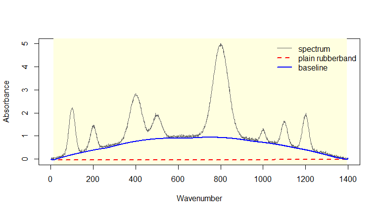
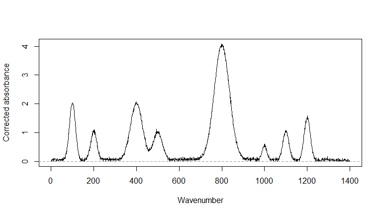

# hullBase

**Baseline correction for FTIR spectra using a refined rubberband
method**

hullBase is an R package for baseline correction of spectra such as
Fourier transform infrared (FTIR) spectra. It builds the plain
rubberband baseline (the lower convex hull of the spectrum) and then
refines only the hull segments that hide a concave region of the
background. Where to refine and how strongly are calculated from the
noise level of the spectrum. The peak width is set by the user.

## Key features

- Rubberband baseline from the lower convex hull, computed in C++
- Input checks with a clear message for each problem
- Noise estimation and detection of hull segments that hide a concave
  region
- Local refinement of only those segments, other segments keep the
  rubberband
- One result object, `BaselineModel`, with `print()`, `summary()` and
  `plot()` methods
- `simulate_spectrum()` for test spectra with a known true baseline

## Installation

hullBase is not on CRAN. Install the development version from GitHub.

``` r
install.packages("remotes")
remotes::install_github("ThanyaManivannan/hullBase", build_vignettes = TRUE)
```

Installing from source compiles C++ code, which on Windows needs
[Rtools](https://cran.r-project.org/bin/windows/Rtools/). A Windows
binary `.zip` on the [Releases
page](https://github.com/ThanyaManivannan/hullBase/releases) installs
without Rtools.

## Quick start

A simulated spectrum is used here because its true baseline is known.

``` r
library(hullBase)

set.seed(1)
sim <- simulate_spectrum(baseline = "concave", snr_db = 30)

fit <- correct(sim, peak_width = 300)
fit
#> <BaselineModel>
#>   method : adaptive (local bending) 
#>   points : 1401 from 0 to 1400 
#>   noise  : 0.0335 
#>   concave segments refined: 1 of 5
```

`peak_width` is the width, in the units of `x`, of the widest peak or
group of overlapping peaks.

``` r
summary(fit)
#> Baseline correction summary
#>   method          : adaptive 
#>   points          : 1401 from 0 to 1400 
#>   noise estimate  : 0.0335 
#>   peak_width      : 300 
#>   threshold       : 0.255 
#>   hull segments   : 5 
#>   segments refined: 1 
#>  x_left x_right n_points max_eroded_gap
#>      13    1396     1384      0.9356579
#>   largest lift above plain rubberband: 0.972 
#>   area between the two baselines     : 866
```

## Example result

``` r
plot(fit)
```



The plain rubberband runs straight under the concave background. The
refined baseline follows it, and the refined segment is shaded.

``` r
plot(fit, which = "corrected")
```



After correction the floor of the spectrum sits at zero.

``` r
c(rubberband = sqrt(mean((fit$rubberband - sim$baseline)^2)),
  hullBase   = sqrt(mean((fit$baseline   - sim$baseline)^2)))
#> rubberband   hullBase 
#> 0.73709461 0.05416515
```

Root mean squared error against the true baseline, for this one
spectrum.

## Input and output

- **Input**, two numeric vectors `x` and `y`, or a data frame with
  columns `x` and `y`
- **`x`**, wavenumbers, each value once, roughly even spacing, any order
- **`y`**, absorbance, peaks pointing upwards, no `NA`, `NaN` or `Inf`
- **Main setting**, `peak_width`, in the units of `x`
- **Output**, a `BaselineModel` object with fields `x`, `y`, `baseline`,
  `corrected`, `rubberband`, `noise`, `peak_width`, `method`, `segments`
  and `call`
- **Methods**, `print()`, `summary()` and `plot()`

`correct(x, y, method = "rubberband")` returns the plain rubberband
baseline for comparison.

## Functions

- `correct()` runs the full correction and returns a `BaselineModel`
- `lower_hull()` gives the plain rubberband baseline
- `noise_estimate()` gives the noise level of a spectrum
- `detect_concave_segments()` finds the hull segments that hide a
  concave region
- `refine_segment()` refines one segment so the baseline follows the
  concave region
- `simulate_spectrum()` makes a test spectrum with a known true baseline

## How well it works

Mean RMSE against the true baseline over 20 simulated spectra for each
row, `peak_width = 300`.

    #>     shape snr_db rubberband hullBase
    #> 1 concave     30      0.745    0.056
    #> 2 concave     20      0.895    0.223
    #> 3   mixed     30      0.787    0.069
    #> 4   mixed     20      0.904    0.204
    #> 5    flat     30      0.089    0.089
    #> 6  linear     30      0.086    0.086
    #> 7  convex     30      0.057    0.057

The error falls on concave and mixed baselines. Flat, linear and convex
baselines are unchanged because no segment is refined. These results
apply to the package simulator with Gaussian peaks, and have not been
established for all measured spectra.

## Documentation

- User guide, `vignette("hullBase")`
- Help pages, for example `?correct` and `?simulate_spectrum`
- Measured example spectra used in testing are loaded from other
  packages and are not shipped with hullBase. SrE.IR comes from
  [ChemoSpec](https://CRAN.R-project.org/package=ChemoSpec) and
  paracetamol from
  [hyperSpec](https://CRAN.R-project.org/package=hyperSpec).
- Source code and issues, <https://github.com/ThanyaManivannan/hullBase>

## Limitations

- `peak_width` is chosen by the user, and a peak wider than it is
  treated as background
- A concave region lower than about 8 noise standard deviations is not
  found
- The baseline is made of straight pieces and is not smooth
- The lowest noise points pull the baseline slightly below the true
  baseline
- Noise is assumed to be the same size across the spectrum
- Repeated wavenumbers stop the correction, and transmittance must be
  converted to absorbance, A = log10(1/T), before calling `correct()`

## Licence and citation

MIT licence. To cite hullBase, run

``` r
citation("hullBase")
```
